<div align="center">

# 🎬 NoSQL Movies & Cinemas REST API


A RESTful API built with **Node.js**, **Express**, and **MongoDB** (via **Mongoose**) to manage a movie catalog and the cinema locations screening them.

Provides a **complete CRUD** for movies with multi-criteria search filters, and a **Cinema CRUD** linked to movies through document references (`ObjectId` + `populate`).

</div>

---

## 📑 Table of Contents

- [Tech Stack](#-tech-stack)
- [Project Structure](#-project-structure)
- [Data Models](#-data-models)
- [Prerequisites](#-prerequisites)
- [Installation & Setup](#-installation--setup)
- [API Endpoints](#-api-endpoints)
  - [Movies `/movies`](#movies-movies)
  - [Cinemas `/cinemas`](#cinemas-cinemas)
- [Usage Examples](#-usage-examples)
- [Error Handling](#-error-handling)
- [Screenshots](#-screenshots)
- [Author](#-author)

---

## 🛠 Tech Stack

| Technology | Version | Purpose |
|---|---|---|
| [Node.js](https://nodejs.org/) | ≥ 18 | JavaScript runtime environment (`node --watch` supported) |
| [Express](https://expressjs.com/) | ^5.2.1 | HTTP server and routing framework |
| [Mongoose](https://mongoosejs.com/) | ^9.10.2 | MongoDB ODM for schemas, models, validation, and queries |
| [MongoDB](https://www.mongodb.com/) | Local | Document-oriented NoSQL database |
| [Postman](https://www.postman.com/) | — | API endpoint testing |

---

## 📁 Project Structure

```text
proyecto5-noSQL-movies-pabloTomeManzano/
├── index.js                 # Entry point: initializes Express and mounts routes
├── package.json
├── utils/
│   └── db.js                # MongoDB connection setup via Mongoose
├── models/
│   ├── Movie.js             # Movie schema and model
│   └── cinema.js            # Cinema schema and model (references Movie)
├── routes/
│   ├── movie.routes.js      # /movies endpoints
│   └── cinema.routes.js     # /cinemas endpoints
├── seeds/
│   └── movies.seed.js       # Initial database seeding script for movies
└── capturas/                # Postman test screenshots
```

---

## 🗂 Data Models

### `Movie`

| Field | Type | Required | Description |
|---|---|:---:|---|
| `title` | `String` | ✅ | Movie title |
| `director` | `String` | ✅ | Movie director |
| `year` | `Number` | ❌ | Release year |
| `genre` | `String` | ✅ | Movie genre |
| `createdAt` / `updatedAt` | `Date` | auto | Automatically generated via `timestamps: true` |

### `Cinema`

| Field | Type | Required | Description |
|---|---|:---:|---|
| `name` | `String` | ✅ | Cinema name |
| `location` | `String` | ✅ | City / Venue address |
| `movies` | `[ObjectId]` → `Movie` | ❌ | Referenced movies currently showing |
| `createdAt` / `updatedAt` | `Date` | auto | Automatically generated via `timestamps: true` |

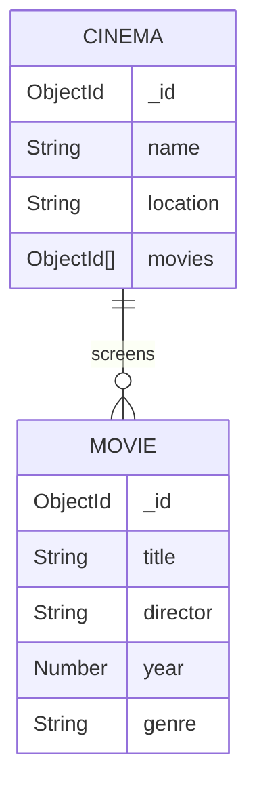

---

## ✅ Prerequisites

- **Node.js** 18 or higher (required for `node --watch`).
- **MongoDB** installed and running locally on the default port `27017`.

To verify that MongoDB is active (Linux with `systemd`):

```bash
sudo systemctl status mongodb
# If not running:
sudo systemctl start mongodb
```

> The application connects to the `proyecto5-noSQL-movies` database at `mongodb://127.0.0.1:27017`. To use a custom connection URI, update [`utils/db.js`](utils/db.js) and [`seeds/movies.seed.js`](seeds/movies.seed.js).

---

## 🚀 Installation & Setup

1. **Clone the repository**

   ```bash
   git clone https://github.com/pablotome8/proyecto5-noSQL-movies-pabloTomeManzano.git
   cd proyecto5-noSQL-movies-pabloTomeManzano
   ```

2. **Install dependencies**

   ```bash
   npm install
   ```

3. **Seed initial movie data**

   ```bash
   node seeds/movies.seed.js
   ```

   This script resets the `movies` collection if populated and inserts 6 sample movies (*The Matrix*, *Buscando a Nemo*, *Interestelar*, etc.).

4. **Start the server**

   ```bash
   npm start      # Production mode
   npm run dev    # Development mode (auto-restarts on file changes)
   ```

   Once started, the console outputs:

   ```text
   Server running in http://localhost:3000
   Conected with db succesfully
   ```

---

## 🔌 API Endpoints

Base URL: `http://localhost:3000`

### Movies `/movies`

| Method | Endpoint | Description | Success Status |
|---|---|:---:|:---:|
| `GET` | `/movies` | Retrieve all movies | `200` |
| `GET` | `/movies/id/:id` | Retrieve a single movie by its `_id` | `200` |
| `GET` | `/movies/title/:title` | Search movies by title (partial & **case-insensitive** match) | `200` |
| `GET` | `/movies/genre/:genre` | Filter movies by genre (exact match) | `200` |
| `GET` | `/movies/year/:year` | Retrieve movies released **after** the given year (`$gt`) | `200` |
| `POST` | `/movies` | Create a new movie | `201` |
| `PUT` | `/movies/:id` | Update an existing movie | `200` |
| `DELETE` | `/movies/:id` | Delete a movie | `200` |

### Cinemas `/cinemas`

| Method | Endpoint | Description | Success Status |
|---|---|:---:|:---:|
| `GET` | `/cinemas` | Retrieve all cinemas with populated `movies` documents (`populate`) | `200` |
| `POST` | `/cinemas` | Create a new cinema | `201` |
| `PUT` | `/cinemas/:id/add-movie` | Add a movie reference to a cinema's billboard (`$addToSet`) | `200` |
| `PUT` | `/cinemas/:id` | Update cinema details | `200` |
| `DELETE` | `/cinemas/:id` | Delete a cinema | `200` |

---

## 🧪 Usage Examples

### Create a Movie

```bash
curl -X POST http://localhost:3000/movies \
  -H "Content-Type: application/json" \
  -d '{
    "title": "Inception",
    "director": "Christopher Nolan",
    "year": 2010,
    "genre": "Sci-Fi"
  }'
```

Response `201 Created`:

```json
{
  "title": "Inception",
  "director": "Christopher Nolan",
  "year": 2010,
  "genre": "Sci-Fi",
  "_id": "6abab4f4bb2592d01bd0ce42",
  "createdAt": "2026-09-28T18:41:56.131Z",
  "updatedAt": "2026-09-28T18:41:56.131Z",
  "__v": 0
}
```

### Search by Title

```bash
curl "http://localhost:3000/movies/title/matrix"
# Returns "The Matrix" and "The Matrix Reloaded"
```

### Movies Released After 2005

```bash
curl http://localhost:3000/movies/year/2005
```

### Update a Movie

```bash
curl -X PUT http://localhost:3000/movies/6abab4f4bb2592d01bd0ce42 \
  -H "Content-Type: application/json" \
  -d '{
    "title": "Inception Director'\''s Cut",
    "director": "Christopher Nolan",
    "year": 2010,
    "genre": "Sci-Fi / Thriller"
  }'
```

### Create a Cinema and Add a Movie to Its Billboard

```bash
# 1. Create the cinema
curl -X POST http://localhost:3000/cinemas \
  -H "Content-Type: application/json" \
  -d '{ "name": "Cines Callao", "location": "Madrid" }'

# 2. Add a movie to its billboard
curl -X PUT http://localhost:3000/cinemas/<CINEMA_ID>/add-movie \
  -H "Content-Type: application/json" \
  -d '{ "movieId": "<MOVIE_ID>" }'
```

The response returns the updated cinema document with the `movies` array fully populated with complete movie objects rather than raw IDs.

---

## ⚠️ Error Handling

- **`404 Not Found`**: Returned when a requested document does not exist:
  ```json
  { "message": "Película no encontrada" }
  ```
- **Validation & Malformed ID Errors**: Any Mongoose exception (missing required fields, invalid `ObjectId`, etc.) is forwarded to the Express error middleware via `next(err)`.

---

## 📸 Screenshots

All endpoints were verified using **Postman** against a local MongoDB instance.

| Test Case | Screenshot |
|---|---|
| Active MongoDB Service | 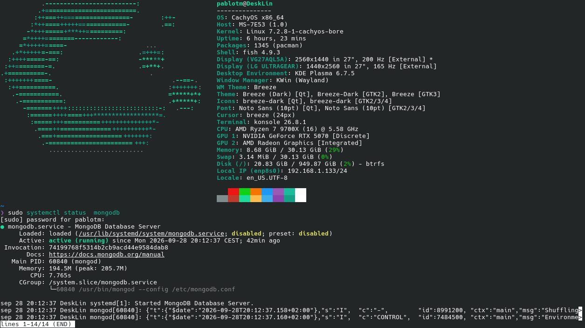 |
| Server Startup (`npm run dev`) | 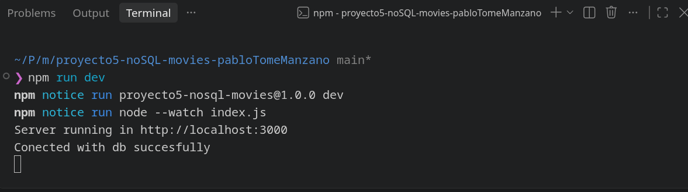 |
| `GET /movies` | 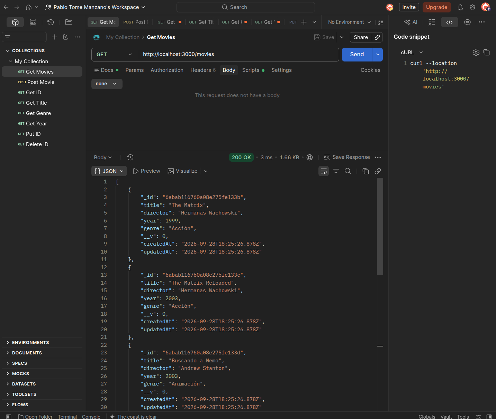 |
| `POST /movies` | 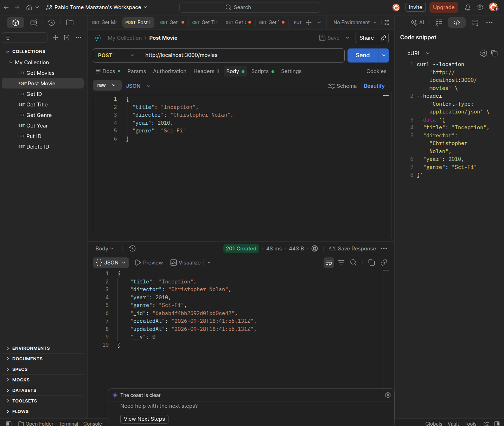 |
| `GET /movies/id/:id` | 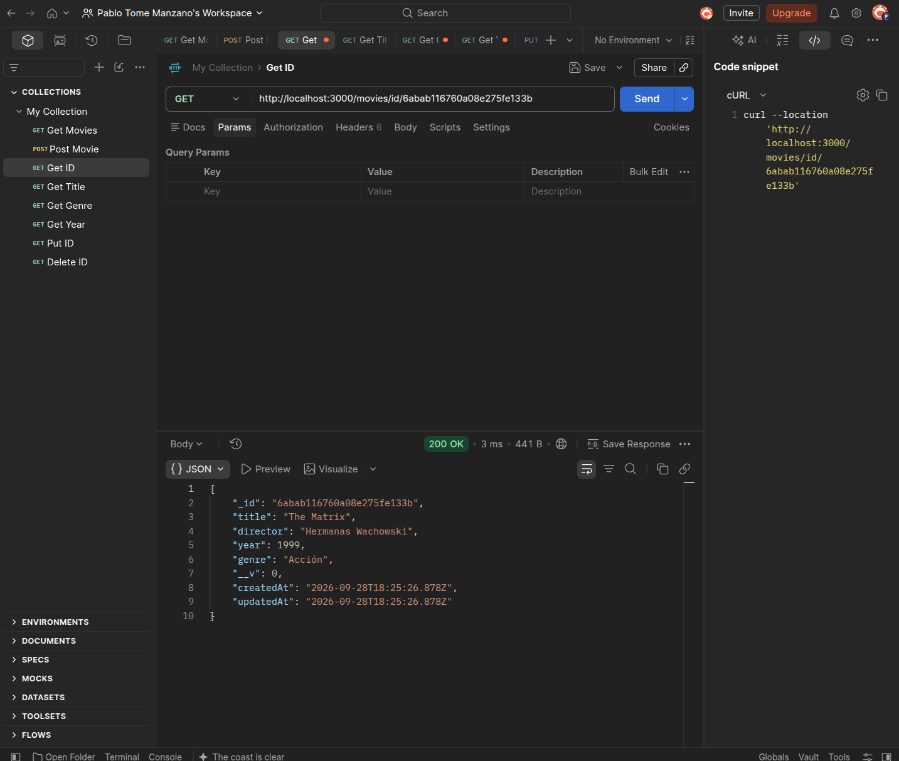 |
| `GET /movies/title/:title` | 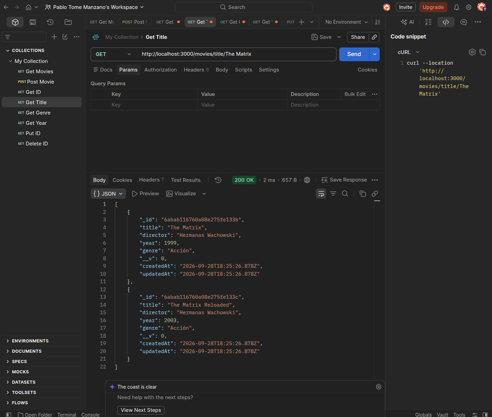 |
| `GET /movies/genre/:genre` | 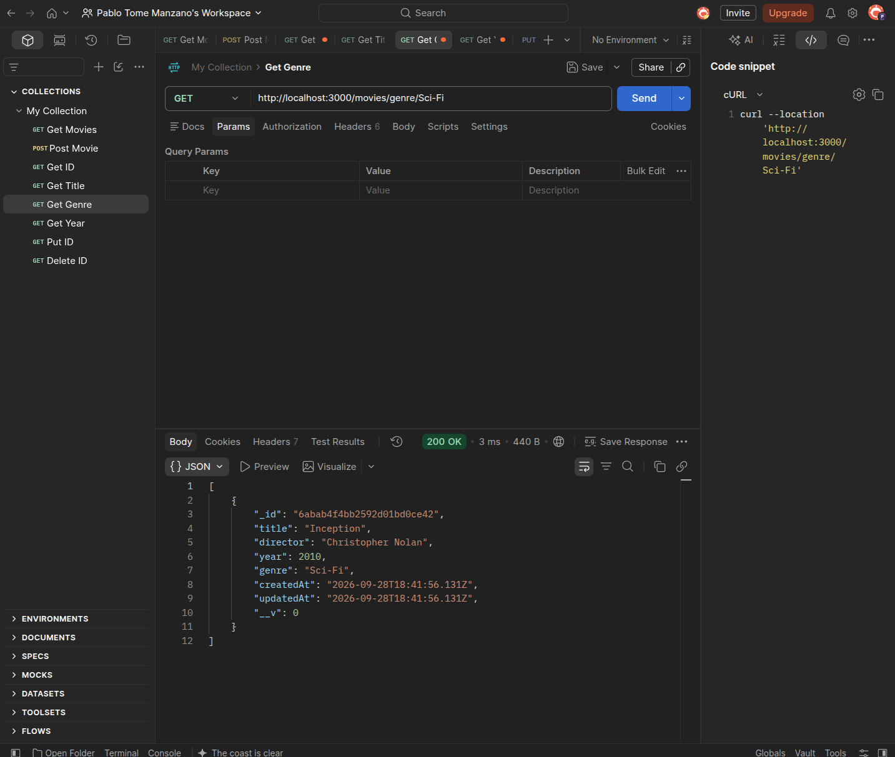 |
| `GET /movies/year/:year` | 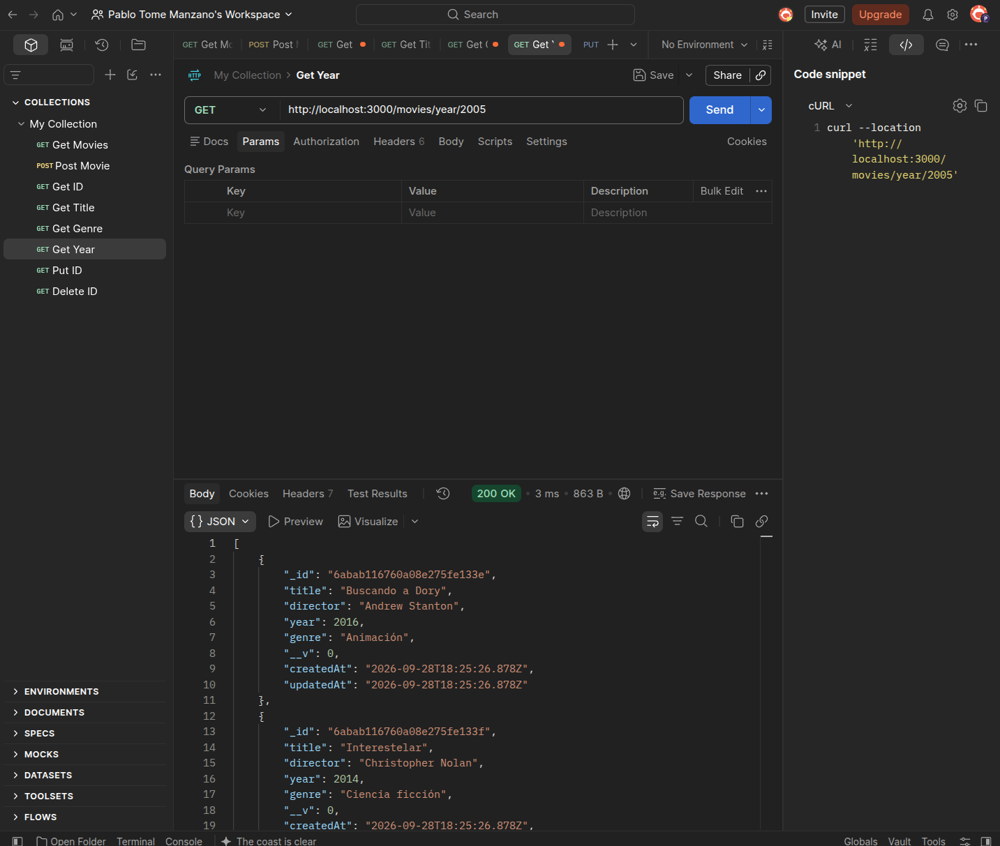 |
| `PUT /movies/:id` | 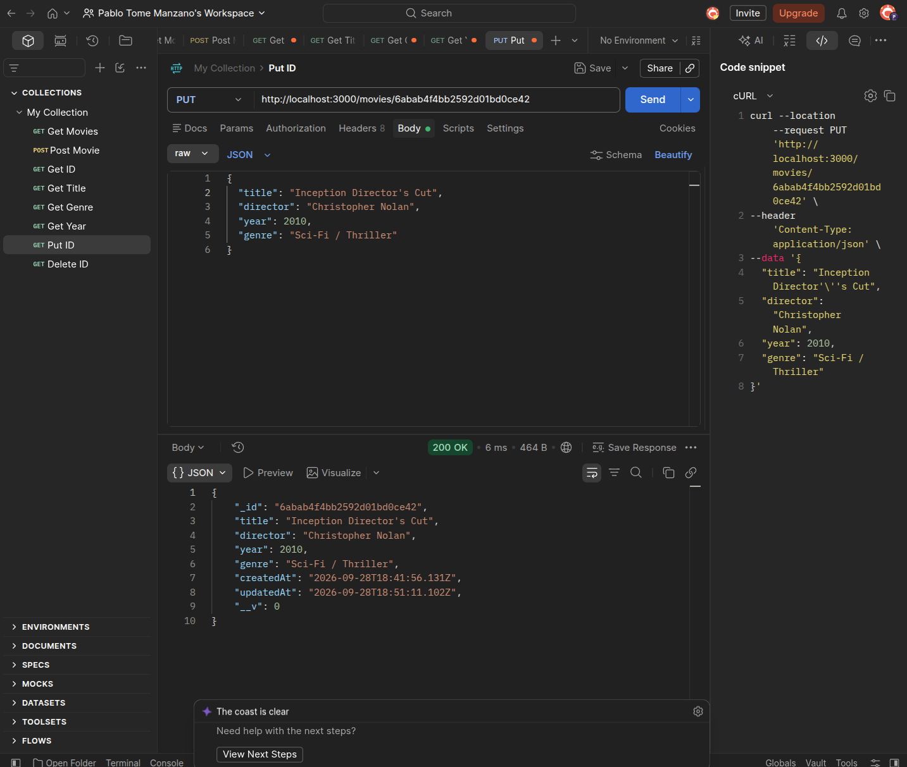 |
| `DELETE /movies/:id` | 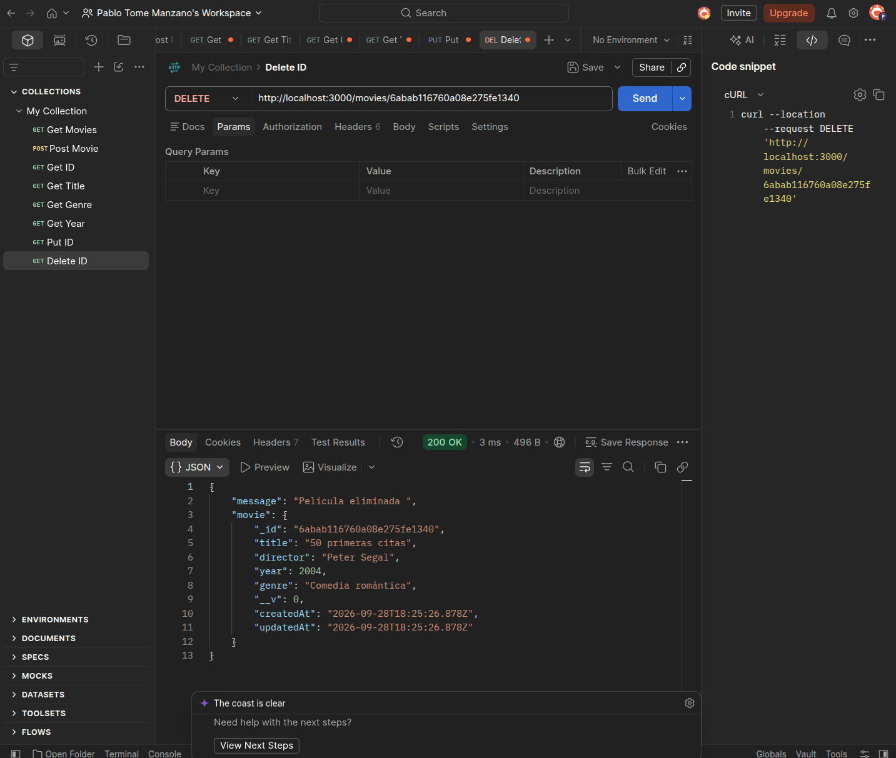 |

---

## 👤 Author

**Pablo Tomé Manzano**  
Project 5 · Master's Module on NoSQL Databases.

- GitHub: [@pablotome8](https://github.com/pablotome8)
