# 🎬 Proyecto 5 · API REST NoSQL de Películas y Cines

API REST hecha con **Node.js**, **Express** y **MongoDB** (a través de **Mongoose**) para gestionar un catálogo de películas y los cines que las proyectan.

Tiene un **CRUD completo** de películas con varios filtros de búsqueda, y un CRUD de cines que se relacionan con las películas mediante referencias (`ObjectId` + `populate`).

---

## 📑 Índice

- [Tecnologías](#-tecnologías)
- [Estructura del proyecto](#-estructura-del-proyecto)
- [Modelos de datos](#-modelos-de-datos)
- [Requisitos previos](#-requisitos-previos)
- [Instalación y puesta en marcha](#-instalación-y-puesta-en-marcha)
- [Endpoints](#-endpoints)
  - [Películas `/movies`](#películas-movies)
  - [Cines `/cinemas`](#cines-cinemas)
- [Ejemplos de uso](#-ejemplos-de-uso)
- [Gestión de errores](#-gestión-de-errores)
- [Capturas de funcionamiento](#-capturas-de-funcionamiento)
- [Autor](#-autor)

---

## 🛠 Tecnologías

| Tecnología | Versión | Uso |
|---|---|---|
| [Node.js](https://nodejs.org/) | ≥ 18 | Entorno de ejecución (se usa `node --watch`) |
| [Express](https://expressjs.com/) | ^5.2.1 | Servidor HTTP y enrutado |
| [Mongoose](https://mongoosejs.com/) | ^9.10.2 | ODM para MongoDB: esquemas, modelos y consultas |
| [MongoDB](https://www.mongodb.com/) | Local | Base de datos NoSQL documental |
| [Postman](https://www.postman.com/) | — | Pruebas de los endpoints |

---

## 📁 Estructura del proyecto

```text
proyecto5-noSQL-movies-pabloTomeManzano/
├── index.js                 # Punto de entrada: arranca Express y monta las rutas
├── package.json
├── utils/
│   └── db.js                # Conexión a MongoDB con Mongoose
├── models/
│   ├── Movie.js             # Esquema y modelo de Película
│   └── cinema.js            # Esquema y modelo de Cine (con referencia a Movie)
├── routes/
│   ├── movie.routes.js      # Endpoints de /movies
│   └── cinema.routes.js     # Endpoints de /cinemas
├── seeds/
│   └── movies.seed.js       # Script de carga inicial de películas
└── capturas/                # Capturas de las pruebas con Postman
```

---

## 🗂 Modelos de datos

### `Movie`

| Campo | Tipo | Obligatorio | Descripción |
|---|---|:---:|---|
| `title` | `String` | ✅ | Título de la película |
| `director` | `String` | ✅ | Director/a |
| `year` | `Number` | ❌ | Año de estreno |
| `genre` | `String` | ✅ | Género |
| `createdAt` / `updatedAt` | `Date` | auto | Generados por `timestamps: true` |

### `Cinema`

| Campo | Tipo | Obligatorio | Descripción |
|---|---|:---:|---|
| `name` | `String` | ✅ | Nombre del cine |
| `location` | `String` | ✅ | Ubicación |
| `movies` | `[ObjectId]` → `Movie` | ❌ | Películas en cartelera (referencias) |
| `createdAt` / `updatedAt` | `Date` | auto | Generados por `timestamps: true` |

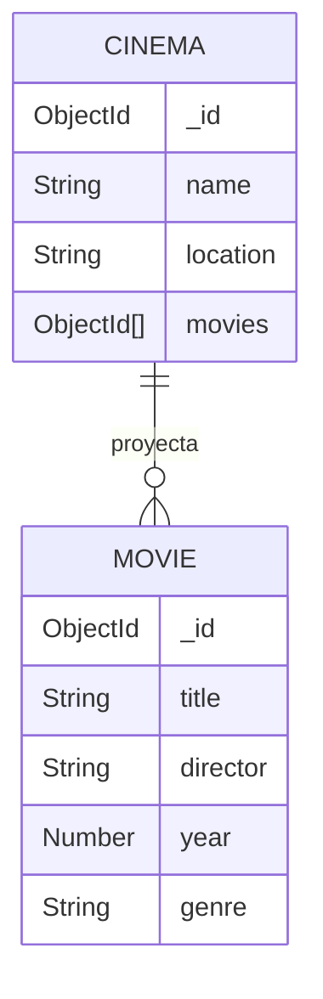

---

## ✅ Requisitos previos

- **Node.js** 18 o superior (hace falta para `node --watch`).
- **MongoDB** instalado y en marcha en local, en el puerto por defecto `27017`.

Para comprobar que MongoDB está activo (Linux con systemd):

```bash
sudo systemctl status mongodb
# Si no está arrancado:
sudo systemctl start mongodb
```

> La aplicación se conecta a la base de datos `proyecto5-noSQL-movies` en `mongodb://127.0.0.1:27017`. Si necesitas otra URL, cámbiala en [`utils/db.js`](utils/db.js) y en [`seeds/movies.seed.js`](seeds/movies.seed.js).

---

## 🚀 Instalación y puesta en marcha

1. **Clonar el repositorio**

   ```bash
   git clone https://github.com/pablotome8/proyecto5-noSQL-movies-pabloTomeManzano.git
   cd proyecto5-noSQL-movies-pabloTomeManzano
   ```

2. **Instalar las dependencias**

   ```bash
   npm install
   ```

3. **Cargar los datos iniciales (seed)**

   ```bash
   node seeds/movies.seed.js
   ```

   El script vacía la colección `movies` si ya tenía datos e inserta 6 películas de ejemplo (*The Matrix*, *Buscando a Nemo*, *Interestelar*…).

4. **Arrancar el servidor**

   ```bash
   npm start      # modo normal
   npm run dev    # modo desarrollo (se reinicia solo al guardar cambios)
   ```

   Si todo va bien, verás en la consola:

   ```text
   Server running in http://localhost:3000
   Conected with db succesfully
   ```

---

## 🔌 Endpoints

URL base: `http://localhost:3000`

### Películas `/movies`

| Método | Ruta | Descripción | Respuesta OK |
|---|---|---|:---:|
| `GET` | `/movies` | Devuelve todas las películas | `200` |
| `GET` | `/movies/id/:id` | Devuelve una película por su `_id` | `200` |
| `GET` | `/movies/title/:title` | Busca por título (coincidencia parcial y **sin distinguir mayúsculas**) | `200` |
| `GET` | `/movies/genre/:genre` | Filtra por género (coincidencia exacta) | `200` |
| `GET` | `/movies/year/:year` | Devuelve las películas estrenadas **después** del año indicado (`$gt`) | `200` |
| `POST` | `/movies` | Crea una película nueva | `201` |
| `PUT` | `/movies/:id` | Modifica una película existente | `200` |
| `DELETE` | `/movies/:id` | Elimina una película | `200` |

### Cines `/cinemas`

| Método | Ruta | Descripción | Respuesta OK |
|---|---|---|:---:|
| `GET` | `/cinemas` | Devuelve todos los cines con sus películas completas (`populate`) | `200` |
| `POST` | `/cinemas` | Crea un cine nuevo | `201` |
| `PUT` | `/cinemas/:id/add-movie` | Añade una película a la cartelera de un cine (`$push`) | `200` |
| `PUT` | `/cinemas/:id` | Modifica los datos de un cine | `200` |
| `DELETE` | `/cinemas/:id` | Elimina un cine | `200` |

---

## 🧪 Ejemplos de uso

### Crear una película

```bash
curl -X POST http://localhost:3000/movies \
  -H "Content-Type: application/json" \
  -d '{
    "title": "Inception",
    "director": "Christopher Nolan",
    "year": 2010,
    "genre": "Sci-Fi"
  }'
```

Respuesta `201 Created`:

```json
{
  "title": "Inception",
  "director": "Christopher Nolan",
  "year": 2010,
  "genre": "Sci-Fi",
  "_id": "6abab4f4bb2592d01bd0ce42",
  "createdAt": "2026-09-28T18:41:56.131Z",
  "updatedAt": "2026-09-28T18:41:56.131Z",
  "__v": 0
}
```

### Buscar por título

```bash
curl "http://localhost:3000/movies/title/matrix"
# Devuelve "The Matrix" y "The Matrix Reloaded"
```

### Películas posteriores a 2005

```bash
curl http://localhost:3000/movies/year/2005
```

### Actualizar una película

```bash
curl -X PUT http://localhost:3000/movies/6abab4f4bb2592d01bd0ce42 \
  -H "Content-Type: application/json" \
  -d '{
    "title": "Inception Director'\''s Cut",
    "director": "Christopher Nolan",
    "year": 2010,
    "genre": "Sci-Fi / Thriller"
  }'
```

### Crear un cine y añadirle una película

```bash
# 1. Crear el cine
curl -X POST http://localhost:3000/cinemas \
  -H "Content-Type: application/json" \
  -d '{ "name": "Cines Callao", "location": "Madrid" }'

# 2. Añadir una película a su cartelera
curl -X PUT http://localhost:3000/cinemas/<ID_CINE>/add-movie \
  -H "Content-Type: application/json" \
  -d '{ "movieId": "<ID_PELICULA>" }'
```

La respuesta trae el cine con el array `movies` ya poblado, es decir, con los documentos completos de las películas y no solo sus IDs.

---

## ⚠️ Gestión de errores

- **`404 Not Found`**: el recurso no existe. Por ejemplo:
  ```json
  { "message": "Película no encontrada" }
  ```
- **Errores de validación o de ID mal formado**: cualquier excepción de Mongoose (campos obligatorios que faltan, `ObjectId` inválido…) se pasa al manejador de errores de Express con `next(err)`.

---

## 📸 Capturas de funcionamiento

Las pruebas se hicieron con **Postman** contra una instancia local de MongoDB.

| Prueba | Captura |
|---|---|
| Servicio MongoDB activo | 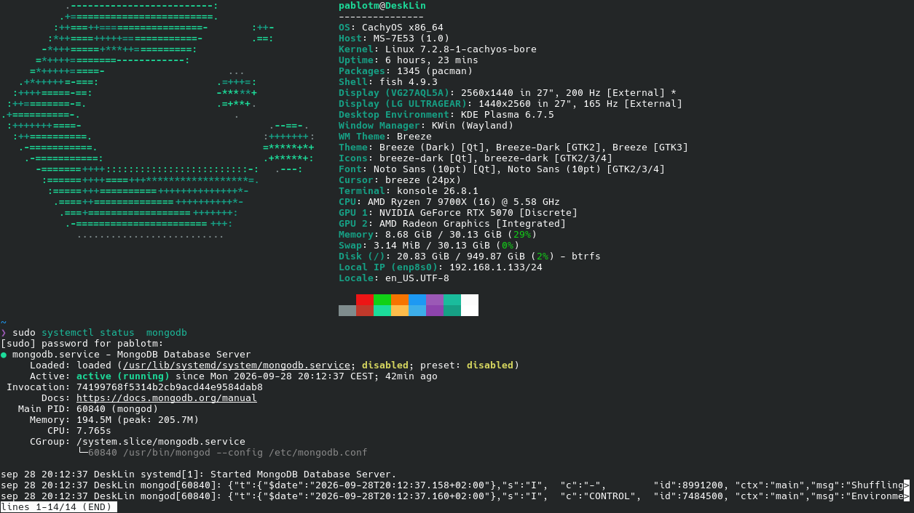 |
| Arranque del servidor (`npm run dev`) | 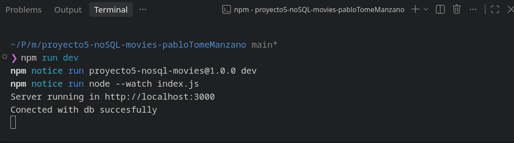 |
| `GET /movies` | 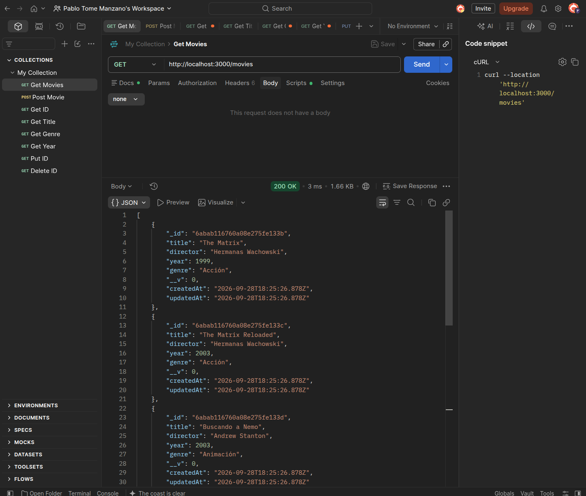 |
| `POST /movies` | 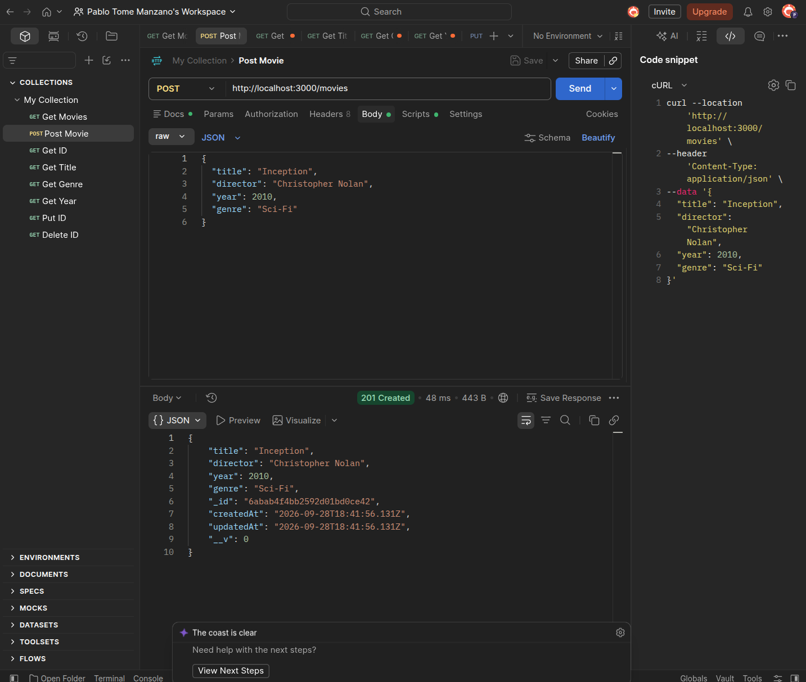 |
| `GET /movies/id/:id` | 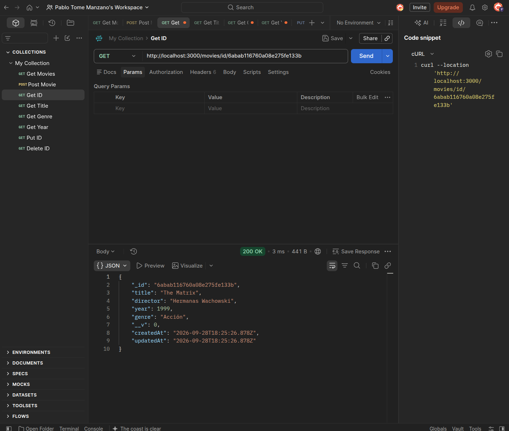 |
| `GET /movies/title/:title` | 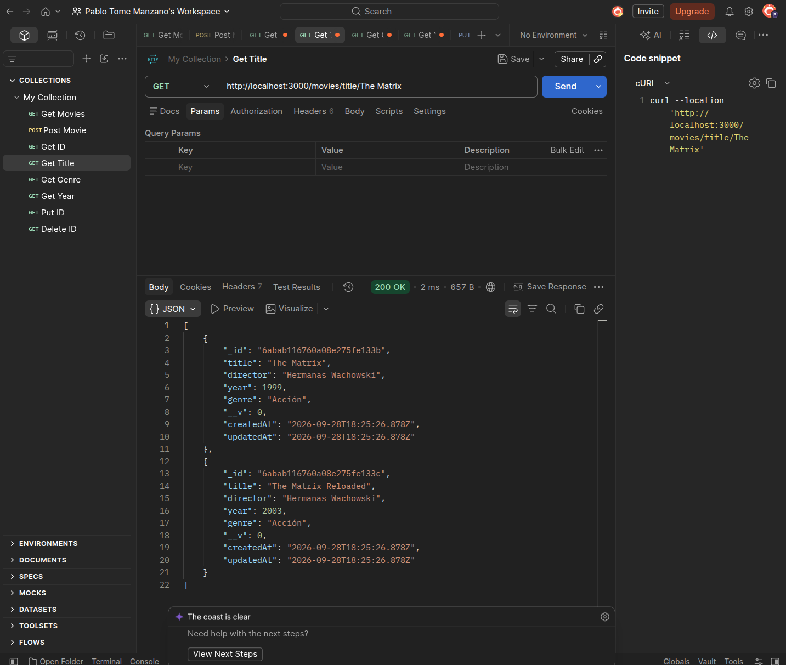 |
| `GET /movies/genre/:genre` | 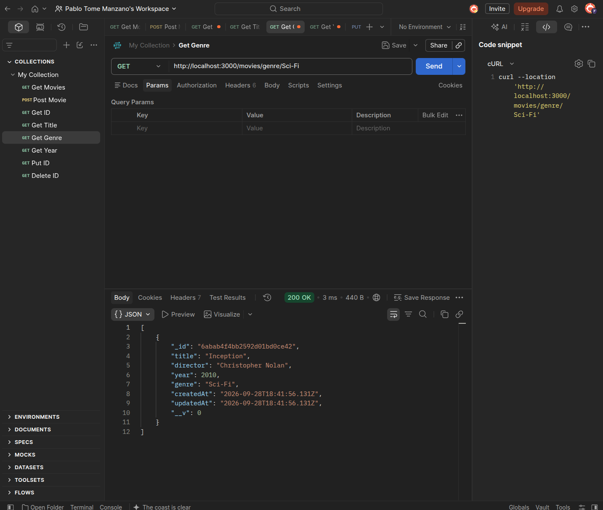 |
| `GET /movies/year/:year` | 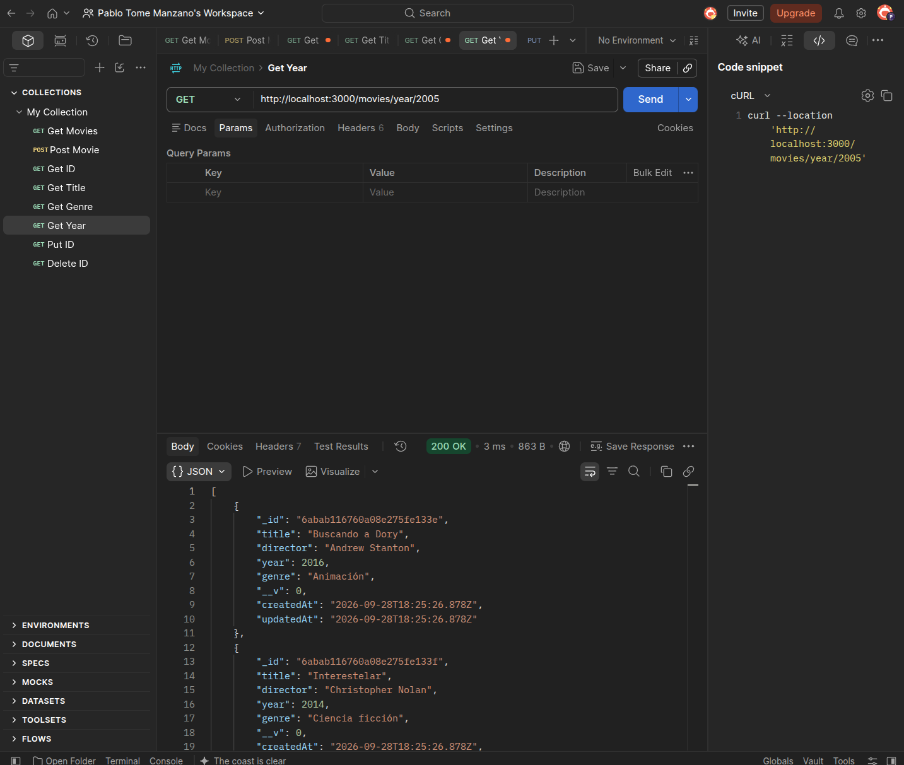 |
| `PUT /movies/:id` | 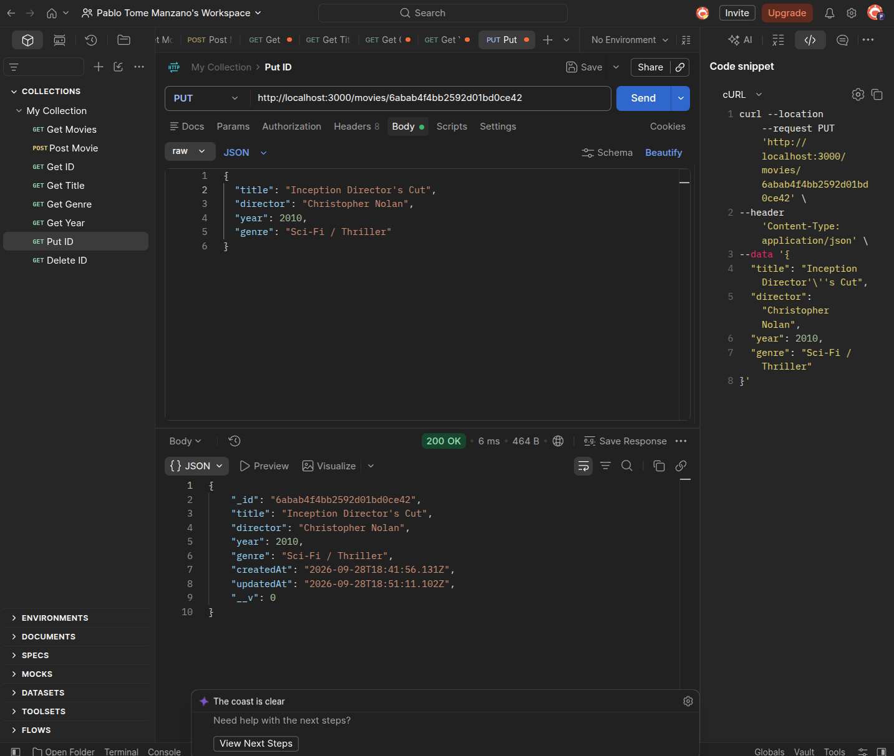 |
| `DELETE /movies/:id` | 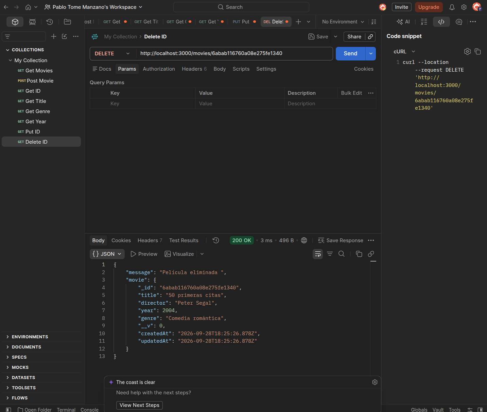 |

---

## 👤 Autor

**Pablo Tomé Manzano**
Proyecto 5 · Máster, módulo de bases de datos NoSQL.

- GitHub: [@pablotome8](https://github.com/pablotome8)
